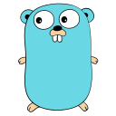

#  sdm_todolist_go_react_vue_npm_sqlite3

# About

```
┌───────────────────────────────────────────────────┐
│                  panedrone's sdm                  │
│               gin version: v1.12.0                │
│                 go sdk: go1.25.0                  │
│              http://127.0.0.1:3301/               │
│                     CPUs: 20                      │
└───────────────────────────────────────────────────┘
```

A project demonstrating how to use [SQL DAL Maker](https://github.com/panedrone/sqldalmaker) + Golang.

[Part 1](internal/gorm): using "github.com/go-gorm/gorm"<br/>
[Part 2](internal/sqlx): using "github.com/jmoiron/sqlx"<br/>
[Part 3](internal/no_orm): using "database/sql" directly

# sdmc

[sdmc](https://github.com/panedrone/sdmc) is SQL DAL Maker as a command-line tool, no IDE needed.
It reads the same [.sdm](.sdm) and `sdm.xml` as the IDE plug-ins: one configuration per part,
[internal/gorm/sdm](internal/gorm/sdm), [internal/sqlx/sdm](internal/sqlx/sdm) and [internal/no_orm/sdm](internal/no_orm/sdm).

```bash
go install github.com/panedrone/sdmc/cmd/sdmc@latest

sdmc gen -c all   # models and DAO of all three parts
sdmc val -c all   # for CI: exit 1 if the generated code is out of date
```

Front-end is written in both React 18.2.0 and Vue 3.5.32. Switch in [handlers.go](internal/etc/handlers.go).


# News

* feat: [sdmc](https://github.com/panedrone/sdmc) instead of go-sdm
* feat: ported to React 18.2.0
* feat: for sdm 1.321.2601 "mockable golang dao"
* feat: [unit-tests](internal/sqlx/handlers) of Gin handlers for GORM, sqlx and No-ORM (thanks to "mockable golang dao") 
* feat: [Swagger](http://localhost:3301/swagger/index.html) annotations for all handlers

# Docker

<table>
<tr>
    <td>
Creating
    </td>
    <td>
sudo docker compose up -d
    </td>
</tr>
<tr>
    <td>
Stopping and Removing
    </td>
    <td>
sudo docker compose down
    </td>
<tr>
    <td>
Updating
    </td>
    <td>
sudo docker compose up --build -d
    </td>
</table>

# sdm.xml

```xml
<sdm>

    <dto-class name="gorm-Project" ref="projects"/>

    <dto-class name="gorm-ProjectLi" ref="projects">
        <field type="int64${json-gorm}" column="p_tasks_count"/>
    </dto-class>

    <dto-class name="gorm-Task" ref="tasks">
        <custom>
            TID // PK
            PID // FK ref. column -> Project
            Project Project `gorm:"foreignKey:PId;references:PId"` // FK -> Project
        </custom>
    </dto-class>

    <dto-class name="gorm-TaskLi" ref="tasks">
        <field column="t_comments" type="-"/>
    </dto-class>

    <dao-class name="ProjectsDao">
        <crud dto="gorm-Project"/>
        <query-dto-list method="ReadAllRaw" dto="gorm-ProjectLi" ref="get_projects.sql"/>
    </dao-class>

    <dao-class name="TasksDao">
        <crud dto="gorm-Task"/>
        <query-dto-list method="RawProjectTasks(int64 p_id)" dto="gorm-TaskLi" ref="get_project_tasks.sql"/>
    </dao-class>

</sdm>
```

The full one: [internal/gorm/sdm/sdm.xml](internal/gorm/sdm/sdm.xml).

# Generated code in action (example)

From the GORM handlers, [internal/gorm/handlers](internal/gorm/handlers):

```go
// Projects
if err := dbal.CreateProject(ctx, &m.Project{PName: req.PName}); err != nil {
    resp.Abort500(ctx, err)
    return
}

all, err := dbal.ReadAllRaw(ctx)
if err != nil {
    resp.Abort500(ctx, err)
    return
}

pr, err := dbal.ReadProject(ctx, uri.PId)
if err != nil {
    if errors.Is(err, gorm.ErrRecordNotFound) {
        resp.Abort404NotFound(ctx, err)
        return
    }
    resp.Abort500(ctx, err)
    return
}

if _, err := dbal.UpdateProject(ctx, &m.Project{PID: uri.PId, PName: req.PName}); err != nil {
    resp.Abort500(ctx, err)
    return
}

if _, err := dbal.DeleteProject(ctx, &m.Project{PID: uri.PId}); err != nil {
    resp.Abort500(ctx, err)
    return
}

// Tasks
if err := dbal.CreateTask(ctx, &t); err != nil {
    resp.Abort500(ctx, err)
    return
}

task, err := dbal.ReadTask(ctx, uri.TId)
if err != nil {
    if errors.Is(err, gorm.ErrRecordNotFound) {
        resp.Abort404NotFound(ctx, err)
        return
    }
    resp.Abort500(ctx, err)
    return
}

tasks, err := dbal.RawProjectTasks(ctx, uri.PId)
if err != nil {
    resp.Abort500(ctx, err)
    return
}

if _, err := dbal.UpdateTask(ctx, task); err != nil {
    resp.Abort500(ctx, err)
    return
}

if _, err := dbal.DeleteTask(ctx, &m.Task{TID: uri.TId}); err != nil {
    resp.Abort500(ctx, err)
    return
}
```
